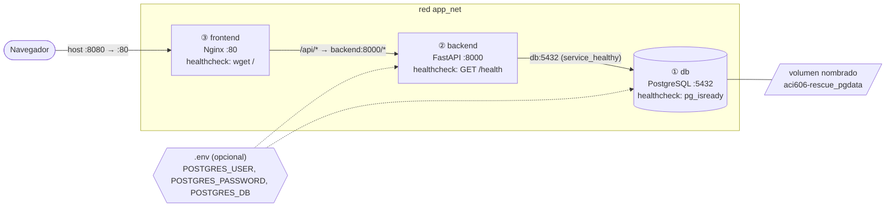

# ACI606 — Docker Rescue Challenge

Aplicación web de tres servicios (**Nginx → FastAPI → PostgreSQL**) recibida con fallas, diagnosticada y reparada
para la Evaluación 2 de ACI606 – Especialidad II: Cloud Computing (UDLA, sección 401).

**Integrantes:** José Molina, Christopher Villalobos, Samantha Rojo

```bash
docker compose up --build -d
docker compose ps        # los 3 servicios deben quedar (healthy)
```

La bitácora completa de cada incidencia (síntoma, evidencia, causa raíz, cambio, justificación, verificación e impacto),
los diagramas de arquitectura inicial y final, y la evidencia de las pruebas están en el **informe técnico (PDF)**
entregado junto a este repositorio.

---

## Contenido

1. [Arquitectura](#1-arquitectura)
2. [Requisitos](#2-requisitos)
3. [Configuración](#3-configuración)
4. [Construir e iniciar](#4-construir-e-iniciar)
5. [Verificar](#5-verificar)
6. [Detener y recrear](#6-detener-y-recrear)
7. [Pruebas de validación (P1–P6)](#7-pruebas-de-validación-p1p6)
8. [Diagnóstico](#8-diagnóstico)
9. [Reparaciones y mejoras](#9-reparaciones-y-mejoras)
10. [Estructura](#10-estructura)

---

## 1. Arquitectura



| Servicio | Imagen | Puerto | Healthcheck | Depende de |
|---|---|---|---|---|
| `frontend` | `nginx:1.27-alpine` (build) | 8080 (host) → 80 | `wget /` | `backend` healthy |
| `backend` | `python:3.12-slim` (build) | 8000 (solo interno) | `GET /health` (ejecuta `SELECT 1`) | `db` healthy |
| `db` | `postgres:16-alpine` | 5432 (solo interno) | `pg_isready` | — |

- **Puerto:** solo el frontend se publica en el host, en el puerto **8080**; backend y base de datos quedan dentro de la red interna.
- **Orden de arranque:** `db` (healthy) → `backend` (healthy) → `frontend`.
- **Comunicación:** los servicios se encuentran por su **nombre de servicio** (`db`, `backend`), nunca por `localhost`.
  Nginx resuelve `backend` en cada petición (`resolver 127.0.0.11`), así que no se cae si el backend se recrea.
- **Persistencia:** los datos de PostgreSQL viven en el volumen nombrado `aci606-rescue_pgdata`, que sobrevive a `docker compose down`.
- **Reinicio:** `restart: unless-stopped` en los tres servicios.
- **Robustez:** si PostgreSQL no responde, toda la API devuelve `503 {"detail":"database unavailable"}` (sin detalles internos)
  y se recupera sola cuando la base de datos vuelve.

## 2. Requisitos

| Herramienta | Comprobar con |
|---|---|
| Docker Engine | `docker --version` |
| Docker Compose v2 | `docker compose version` |
| curl | `curl --version` |

Funciona tal cual en **GitHub Codespaces**: [.devcontainer/devcontainer.json](.devcontainer/devcontainer.json) usa la imagen
`mcr.microsoft.com/devcontainers/universal:2` (trae Docker) y reenvía el puerto 8080.

## 3. Configuración

La aplicación se publica siempre en **http://localhost:8080**. Las credenciales de PostgreSQL tienen un **valor por defecto** en `compose.yaml`: un clon limpio funciona **sin crear `.env`**.
Para cambiarlas:

```bash
cp .env.example .env     # .env está en .gitignore y nunca se versiona
```

| Variable | Por defecto | Uso |
|---|---|---|
| `POSTGRES_USER` | `appuser` | Usuario de PostgreSQL; también arma `DATABASE_URL` |
| `POSTGRES_PASSWORD` | `rescue123` | Contraseña de PostgreSQL; también arma `DATABASE_URL` |
| `POSTGRES_DB` | `appdb` | Base de datos; también arma `DATABASE_URL` |

`DATABASE_URL` (backend) y `BACKEND_HOST`/`BACKEND_PORT` (frontend) se derivan en `compose.yaml` y normalmente no se cambian.
Si falta `DATABASE_URL`, el backend termina con `RuntimeError` en lugar de usar una credencial escondida en el código.

> **Importante:** `POSTGRES_*` solo se aplican cuando PostgreSQL inicializa un volumen **vacío**. Si el volumen ya existe,
> cambiar `POSTGRES_PASSWORD` en `.env` no cambia la contraseña guardada. Cámbiela también en la base de datos:
> `docker compose exec db psql -U appuser -d appdb -c "ALTER USER appuser PASSWORD 'nueva';"`

## 4. Construir e iniciar

Desde la **raíz** del repositorio:

```bash
docker compose config -q && echo "compose.yaml válido"
docker compose up --build -d
docker compose ps
```

En 20–30 s los tres servicios deben figurar `(healthy)`:

```
NAME                       SERVICE    STATUS                    PORTS
aci606-rescue-backend-1    backend    Up ... (healthy)          8000/tcp
aci606-rescue-db-1         db         Up ... (healthy)          5432/tcp
aci606-rescue-frontend-1   frontend   Up ... (healthy)          0.0.0.0:8080->80/tcp
```

Abra http://localhost:8080 (en Codespaces: pestaña **Ports** → 8080). La página debe mostrar
`Backend: ok | DB: reachable` y permite crear y listar registros.

## 5. Verificar

Prueba automática de extremo a extremo:

```bash
./scripts/smoke_test.sh                  # frontend, /api/health, crear, listar y rechazar nombre vacío (422)
./scripts/smoke_test.sh --persistencia   # además recrea los contenedores y comprueba que el registro sigue ahí
```

O manualmente:

```bash
curl -s -o /dev/null -w "%{http_code}\n" http://localhost:8080/        # 200
curl -s http://localhost:8080/api/health                                 # {"status":"ok","database":"reachable"}
curl -s -X POST http://localhost:8080/api/items \
     -H "Content-Type: application/json" -d '{"name":"mi registro"}'     # 201 con el registro creado
curl -s http://localhost:8080/api/items                                  # lista de registros
docker compose exec db psql -U appuser -d appdb -c "SELECT * FROM items;"
```

| Endpoint (vía Nginx) | Método | Respuesta |
|---|---|---|
| `/` | GET | Interfaz web |
| `/api/health` | GET | `200` si la API y PostgreSQL responden; `503` si la base de datos no está disponible |
| `/api/items` | GET | Lista de registros |
| `/api/items` | POST | Crea un registro (`{"name": "..."}`, 1 a 80 caracteres) |

## 6. Detener y recrear

```bash
docker compose stop          # detiene los contenedores (se reanudan con: docker compose start)
docker compose down          # elimina contenedores y red; el volumen de datos se CONSERVA
docker compose up --build -d # recrea todo; los registros siguen ahí
```

> ⚠️ **`docker compose down -v` borra el volumen `aci606-rescue_pgdata` y con él todos los datos.**
> Úselo solo para reiniciar la base de datos desde cero.

## 7. Pruebas de validación (P1–P6)

Las seis pruebas obligatorias de la pauta, listas para ejecutar en orden:

| Prueba | Comandos | Resultado esperado |
|---|---|---|
| **P1** Arranque limpio | `docker compose down`<br/>`docker compose up --build -d`<br/>`docker compose ps` | `db` → `backend` → `frontend`, los tres `(healthy)` |
| **P2** Comunicación | `curl -s http://localhost:8080/api/health`<br/>`curl -s -X POST http://localhost:8080/api/items -H "Content-Type: application/json" -d '{"name":"prueba P2"}'`<br/>`docker compose exec db psql -U appuser -d appdb -c "SELECT * FROM items;"` | `reachable`; `201`; el registro aparece en PostgreSQL |
| **P3** Persistencia | `docker compose down && docker compose up -d`<br/>`docker compose up -d --force-recreate db`<br/>`curl -s http://localhost:8080/api/items` | El registro de P2 sigue presente tras ambas recreaciones |
| **P4** Fallo controlado | `docker compose stop db`<br/>`curl -s -o /dev/null -w "%{http_code}\n" http://localhost:8080/`<br/>`curl -s -w " %{http_code}\n" http://localhost:8080/api/items` | La página sigue en `200`; la API responde `503 database unavailable` |
| **P5** Diagnóstico | `docker compose ps`<br/>`docker compose logs --tail=20 backend`<br/>`docker inspect --format '{{json .State.Health}}' aci606-rescue-backend-1` | `backend` pasa a `(unhealthy)`; el log muestra el `WARNING` con la causa (`could not translate host name "db"`) |
| **P6** Recuperación | `docker compose start db`<br/>(esperar ~30 s)<br/>`docker compose ps`<br/>`curl -s http://localhost:8080/api/health` | Los tres `(healthy)` otra vez, sin reiniciar el backend; datos intactos |

## 8. Diagnóstico

| Síntoma | Qué revisar |
|---|---|
| Un servicio no figura `healthy` | `docker compose ps -a` · `docker compose logs <servicio>` · `docker inspect --format '{{json .State.Health}}' aci606-rescue-<servicio>-1` |
| `/api/...` responde **502** | El backend está detenido o no resuelve: `docker compose ps backend` · `docker compose logs frontend \| grep error` |
| `/api/...` responde **503** | El backend funciona pero no alcanza PostgreSQL: `docker compose ps db` · `docker compose logs db` |
| `password authentication failed` | `.env` y la contraseña guardada en el volumen no coinciden (ver [Configuración](#3-configuración)) |
| No responde en http://localhost:8080 | `docker compose ps frontend` (columna PORTS debe mostrar `0.0.0.0:8080->80/tcp`) · `docker compose logs frontend` |
| Ver la configuración efectiva | `docker compose config` · `docker compose exec frontend cat /etc/nginx/conf.d/default.conf` |
| Red y volumen | `docker network inspect aci606-rescue_app_net` · `docker volume inspect aci606-rescue_pgdata` |

## 9. Reparaciones y mejoras

Cada fila corresponde a **un commit** del historial (`git log --oneline --reverse`). El detalle completo está en el informe técnico.

| ID | Problema encontrado | Corrección | Commit |
|---|---|---|---|
| R-01 | El backend terminaba con `Exited (1)`: `uvicorn` buscaba el módulo `app`, que no existe | `CMD` apunta a `main:app` | [`6153037`](https://github.com/Skukiko/docker_rescue_student/commit/6153037be0f88dec1078806d5c3ba591e404e573) |
| R-02 | `ModuleNotFoundError: psycopg2`: faltaba el driver de PostgreSQL | `psycopg2-binary==2.9.10` en `requirements.txt` | [`5e08230`](https://github.com/Skukiko/docker_rescue_student/commit/5e0823046d34fbcbbeb797ed65ed6c095b25a484) |
| R-03 | `DATABASE_URL` usaba `localhost`, que dentro del contenedor es el propio backend | Host `db` (nombre del servicio) | [`5bf2ad3`](https://github.com/Skukiko/docker_rescue_student/commit/5bf2ad3e93cffa92656fbc47cf2df30941ea3653) |
| R-04 | `password authentication failed`: la URL usaba `wrongpass` | Misma contraseña que `POSTGRES_PASSWORD` | [`c3401b4`](https://github.com/Skukiko/docker_rescue_student/commit/c3401b498d8b66ad4e621ac326a6e5c6f128a0dd) |
| R-05 | `depends_on` simple no esperaba a que PostgreSQL aceptara conexiones | Healthcheck `pg_isready` + `condition: service_healthy` | [`88d3387`](https://github.com/Skukiko/docker_rescue_student/commit/88d3387c84e3edc9876651b6c7f8ec8860641cfd) |
| R-06 | El frontend figuraba `Up` pero no respondía: se publicaba `8080:8080` y Nginx escucha en el 80 | Puerto `8080:80` | [`d611282`](https://github.com/Skukiko/docker_rescue_student/commit/d6112829dfbd518ff1aa5e8a206e88f385fafda7) |
| R-07 | `502 Bad Gateway`: Nginx reenviaba `/api/` a `localhost:8000` | `proxy_pass` hacia `backend:8000` | [`64d44c9`](https://github.com/Skukiko/docker_rescue_student/commit/64d44c96c9f889356d80e014353fe2fecd91c01c) |
| R-08 | Los datos se perdían en `down`/`up` (volumen anónimo) | Volumen nombrado `pgdata` | [`e721a7e`](https://github.com/Skukiko/docker_rescue_student/commit/e721a7e70ffa3da6e5195d577d0f9cfc1fa0f924) |
| M-01 | Configuración rígida y credencial por defecto en el código | Variables con valores por defecto, `.env.example` | [`45ceef1`](https://github.com/Skukiko/docker_rescue_student/commit/45ceef1409844cb8eac74106c4cbf7cca037a014) |
| M-02 | Servicios "Up" pero no necesariamente sanos | Healthchecks en backend y frontend, `restart`, red `app_net` | [`9b4747c`](https://github.com/Skukiko/docker_rescue_student/commit/9b4747ce9334ff49cd3754a9235f2456ce389a24) |
| M-03 | Nginx no arrancaba si el backend no existía | Resolver DNS de Docker y destino por variables | [`9ccc0ae`](https://github.com/Skukiko/docker_rescue_student/commit/9ccc0ae8cba5cd3b4f059f78983830ea63aaa5b2) |
| M-04 | Sin instrucciones reproducibles | README y `devcontainer.json` | [`888a2e3`](https://github.com/Skukiko/docker_rescue_student/commit/888a2e3035828089ca495e4f866dd7009a90030e) |
| M-05 | Con la base de datos caída la API respondía 500 con traceback; backend como root; Nginx exponía su versión | 503 en toda la API, `USER appuser`, `server_tokens off`, cabeceras de seguridad y `smoke_test.sh` | [`c729fb6`](https://github.com/Skukiko/docker_rescue_student/commit/c729fb6a22b60b20ffb749c3d67b1314f3f30790) · [`9df96f2`](https://github.com/Skukiko/docker_rescue_student/commit/9df96f2efe6b7baf1ac4543c9972e496de7e54f9) · [`6bbc079`](https://github.com/Skukiko/docker_rescue_student/commit/6bbc07973a79d89cb96945d8ae6bab99edb8673b) |

## 10. Estructura

```
.
├── compose.yaml                     # servicios, healthchecks, red app_net, volumen pgdata
├── .env.example                     # plantilla de configuración (copiar a .env)
├── .gitignore
├── .devcontainer/devcontainer.json  # Codespaces con Docker y puerto 8080
├── backend/
│   ├── Dockerfile                   # python:3.12-slim, uvicorn main:app, usuario sin privilegios
│   ├── .dockerignore
│   ├── main.py                      # API FastAPI: /health, /items
│   └── requirements.txt
├── frontend/
│   ├── Dockerfile                   # nginx:1.27-alpine; nginx.conf como plantilla (envsubst)
│   ├── .dockerignore
│   ├── index.html
│   └── nginx.conf                   # proxy /api/ → backend + cabeceras de seguridad
└── scripts/smoke_test.sh            # prueba de extremo a extremo (opción --persistencia)
```
