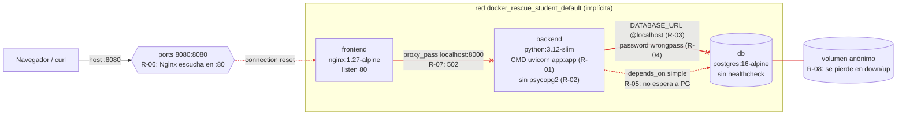
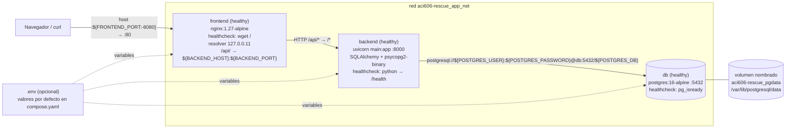

# Arquitectura

## Estado inicial (paquete recibido)

Cada flecha roja corresponde a una falla documentada en `bitacora/`.



| ID | Punto de falla |
|---|---|
| R-01 | `backend/Dockerfile` usa `app:app`, pero el módulo es `main.py` |
| R-02 | falta `psycopg2-binary` en `requirements.txt` |
| R-03 | `DATABASE_URL` apunta a `localhost` |
| R-04 | contraseña `wrongpass` ≠ `POSTGRES_PASSWORD` |
| R-05 | `depends_on` sin condición de salud |
| R-06 | `ports: 8080:8080`, pero Nginx escucha en el 80 |
| R-07 | `proxy_pass http://localhost:8000/` |
| R-08 | datos en un volumen anónimo |

## Estado final



### Orden de arranque y recuperación

```mermaid
sequenceDiagram
    participant C as docker compose
    participant D as db
    participant B as backend
    participant F as frontend
    C->>D: start
    loop cada 5s (hasta 10 veces)
        C->>D: pg_isready
    end
    D-->>C: healthy
    C->>B: start (depends_on: service_healthy)
    loop cada 10s
        C->>B: GET 127.0.0.1:8000/health (SELECT 1)
    end
    B-->>C: healthy
    C->>F: start (depends_on: service_healthy)
    Note over F,B: Nginx resuelve "backend" en cada petición:<br/>si el backend cae → 502 en /api/, la página sigue en 200;<br/>cuando vuelve → se recupera sin reiniciar Nginx.
    Note over B,D: si db cae → /health 503 → backend unhealthy;<br/>cuando vuelve, pool_pre_ping reconecta.
```

### Decisiones

| Aspecto | Decisión | Motivo |
|---|---|---|
| Descubrimiento de servicios | Nombres DNS de Compose (`db`, `backend`) | `localhost` es el propio contenedor (R-03, R-07) |
| Orden de arranque | `depends_on: condition: service_healthy` | "Iniciado" ≠ "listo para conexiones" (R-05) |
| Persistencia | Volumen nombrado + `name: aci606-rescue` | El nombre no depende de la carpeta; sobrevive a `down` (R-08) |
| Configuración | Variables con valores por defecto + `.env.example` | Una sola fuente de credenciales; un clon limpio funciona (M-01) |
| Resiliencia | Healthchecks, `restart: unless-stopped`, resolver DNS en Nginx | Fallas acotadas y recuperación automática (M-02, M-03) |
